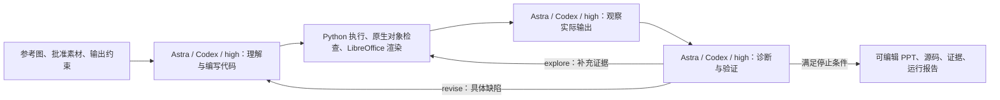

> 历史设计规格：初版固定 Astra/high。公开版本已按用户授权支持配置 Codex 模型和推理强度，新运行协议为 codex_internal_v1；实际用法与实现范围以 README 为准。

# PPTBench Astra Harness 实施规格 v1.0

本文件是待实现工程的规范，不是已完成实现或已通过测试的声明。目标目录：`/path/to/refletive-ppt-agent`。编写日期：2026-10-13。

实现者必须按本文完成代码、配置、测试和真实任务运行。文中“必须”是验收要求；标注为“项目约定”的接口需要新建；标注为“上游接口”的接口已在指定版本源码中核对。不能用伪造图片、模拟模型响应或合成题替代真实 PPTBench 验收。

## 1. 目标和边界

实现一个将科研流程图重建成单页、原生可编辑 PPT 的闭环系统：



所有承担智能判断的角色统一使用 `gpt-6-astra`、Codex CLI、`model_reasoning_effort="high"`。生成、视觉观察、语义核对、细节检测、修复均不引入其他模型。执行器、渲染器、哈希校验器、评分器、状态机是确定性程序，不需要为了对应流程图而额外调用模型。

第一版任务范围仅为 PPTBench 的单图到单页 PPT 重建。不实现文档到多页演示文稿、主题模板选择、跨页叙事，也不训练模型。先单任务串行跑通，再实现多任务调度。

完成的含义分为两层：

- 工程完成：输入真实任务后能执行完整闭环，正确记录失败、停止、恢复和交付；测试通过。
- 单题质量达标：通过文件检查和内部语义/可读性检测，内部细节分达到配置阈值。工程完成不意味着每道题都达标。

## 2. 核实过的事实与版本边界

### 2.1 当前机器

- Codex CLI：`0.160.0`，可从 PATH 找到。
- 本机默认 model 是 `gpt-6-astra`，provider 由用户本地配置，默认 reasoning effort 是 `medium`。每次调用必须显式指定 high，不能依赖默认值。
- 已核对 `codex exec --help` 支持 `--model`、`--config`、`--image`、`--output-schema`、`--output-last-message`、`--json`、`--ephemeral`、`--cd` 和 `--skip-git-repo-check`。
- 本机为 macOS，Python 3.13；当前未发现 `uv`、Docker、LibreOffice。本文不假设这些依赖已经可用。
- 本次没有发起付费模型调用，尚未验证 provider 的实际响应、图像输入或 JSON Schema 支持。doctor 的真实探针必须补齐这些验证。
- 尝试读取官方 Codex 在线文档未成功取得正文。因此本规格中的 CLI 参数依据本机 help 和冻结的 PPTBench 源码，不将在线文档链接当成已验证行为证据。

### 2.2 冻结上游

PPTBench 仓库：`https://github.com/Einsia/PPTBench`。

固定 commit：`d64c09f10a4376fa46532dc82048d1b5228e8b76`。

复用这个 commit 的以下内容：

- `benchmark/materialization_manifest.jsonl`、`benchmark/tasks/`、`configs/taskset.txt`：真实题目来源、哈希、素材索引。
- `arxiv_flow_dataset.task_materializer`：下载、重建并验证参考图和批准素材。
- `eval_harness.pptx`：原生对象提取、资源使用检查、PPTX 验证、LibreOffice 渲染。
- `vlm_judge_harness.judge`：图像预处理、官方检测输出结构及验证逻辑。
- `configs/vlm_judge/semantic_gate.txt`、`render_gate.txt`、`detail_findings.txt`：检测标准。
- `vlm_judge_harness.issue_ranker`、`consensus_ranker`：确定性扣分与三轮合并。

不要重写一套“差不多”的官方评分规则。上游升级必须单独修改锁定 commit、重新跑兼容性测试，不能静默跟随 main。

### 2.3 参考框架如何落实

参考仓库是研究地图，不是可直接导入的 harness SDK。复用它的 code → execute/render → observe → verify → repair 机制。我们的实现用一个 `run_id` 下的持久化轨迹串联多个独立 Codex 调用；这是系统级闭环，不宣称所有阶段都在同一个 Codex 原生会话中。

## 3. 固定架构决策

1. 主语言 Python，推荐 Python 3.11；CLI 用 argparse；数据校验用 Pydantic v2；测试用 pytest；PPT 生成用 python-pptx；图像与 PDF 工具用 Pillow、PyMuPDF。与上游共享依赖时，以固定上游要求为准，生成 lock 文件并运行依赖检查。
2. 通过 `codex exec` 子进程调用已安装 Codex，不另建 OpenAI API 客户端，不要求用户重复配置 API key。
3. 每个智能阶段启动新会话，使用 `--ephemeral`。跨阶段信息由显式文件传递；不使用 `resume --last`，避免串题。
4. 写代码与检查结果分离。检测器不读取作者的自评、既有分数或其他检测轮的结论；只看本轮指定证据。
5. V1 使用 Python `build.py` + 项目原生图形辅助库。允许使用底层 OOXML 表达 python-pptx 未覆盖的箭头和样式，但必须通过实际 PPTX 检查与渲染。
6. 每个候选版本不可变保存。修复从当前最佳版本复制出新版本，不能原地覆盖已评分候选。
7. 自定义内部检测用 Astra high；官方论文配置 Luna high 仅是未来可选的独立最终评测，不属于默认流水线，也不在本次实现中偷偷调用。
8. 默认实验不依赖网络搜索、图片生成、额外 OCR 模型或其他多模态服务。素材只能来自题目批准清单；OCR 若以后加入必须单独标注实验变体。

## 4. 运行环境与隔离

### 4.1 两个运行模式

`local-dev`：macOS 本机开发与真实题冒烟。安装 LibreOffice 后可运行自定义闭环。结果始终标记 `official_comparable=false`。Codex workspace-write 主要约束写入，不等价于隐藏同机其他文件；不能声称该模式已经达到官方数据隔离。

`benchmark`：Linux/WSL2 或等价 Linux VM，原生 Linux Codex、Bubblewrap、LibreOffice 25.8、固定字体集。必须继承上游隔离思路，限制 agent 可见目录，只提供题目图像和批准资源、运行库、最小连接配置。不能仅把 `cwd` 切到工作目录就称为隔离。容器中运行 bwrap 还需验证 user namespace 能力，不假设普通 Docker 默认配置一定支持。

跨平台迁移时，复用本机 provider 的实际连接设置和认证方式；不要推断 本地 provider 使用哪种密钥。只在本地最小运行配置中保留必要字段，不输出完整 config/auth，不提交凭据。认证环境能否在 Linux 使用由 doctor 验证。

### 4.2 可见内容

生成器：参考图、批准素材、任务约束、辅助库、上一最佳版本源码、局部修复反馈。

检测器：参考图、候选渲染图、标准比较图、坐标变换信息；可在自身 scratch 中裁剪和测量。用于诊断定位的对象表在独立 diagnose 阶段提供，不改变盲评判分输入。

不向 agent 提供：`source.pdf`、论文标题/图注/来源 metadata、官方既有结果、其他任务数据、整个研究工作目录。PPTBench materialize 会生成 `source.pdf`，它必须留在主控数据区，不能复制进 agent 输入区。

### 4.3 前置安装步骤

以下为开始实现时执行的真实命令，不在本次文档任务中执行安装：

```bash
cd /path/to/refletive-ppt-agent
mkdir -p vendor
git clone https://github.com/Einsia/PPTBench.git vendor/PPTBench
git -C vendor/PPTBench checkout d64c09f10a4376fa46532dc82048d1b5228e8b76
python3.11 -m venv .venv
. .venv/bin/activate
python -m pip install -e ./vendor/PPTBench
```

`python3.11` 不存在时先安装；macOS 可用 Homebrew 安装 `python@3.11` 与 `libreoffice`，再解析实际安装路径。Linux 需要 `python3-venv bubblewrap libreoffice-impress`；发行版安装不保证 LibreOffice 是 25.8，因此 benchmark 模式必须额外验证版本，版本不符就阻止可比性声明。

项目代码建立后，再执行 `python -m pip install -e '.[dev]'` 和 `python -m pip check`。将解析得到的依赖版本锁定。保存 Python、Codex、LibreOffice、字体文件哈希与 OS 信息到 environment.json。

## 5. 仓库结构和职责

以下目录为待实现目标：

```text
harness/
  IMPLEMENTATION_SPEC.md
  README.md
  pyproject.toml
  requirements.lock
  .gitignore
  configs/default.toml
  configs/tasks-smoke.txt
  configs/tasks-dev.txt
  prompts/{understand,author,repair,diagnose}.txt
  schemas/                         # 从 Pydantic 导出的版本化 JSON Schema
  src/pptbench_harness/
    cli.py                         # 命令入口，退出码
    config.py                      # 配置解析与冻结
    models.py                      # 项目数据模型
    orchestrator.py                 # 唯一有权推进状态和选 best 的组件
    codex_runner.py                 # 子进程、JSONL、输出验证、超时
    dataset.py                     # 调用上游 materialize；构建脱敏 TaskInput
    workspace.py                   # 候选快照、隔离、哈希、路径边界
    executor.py                    # 执行 build.py、资源与进程限制
    renderer.py                    # 上游 renderer 的薄适配层
    validator.py                   # 上游 Stage 0 的薄适配层
    observer.py                    # 比较图、放大图、坐标变换
    critic.py                      # 三阶段 × 三轮 Astra 检测
    scorer.py                      # 调用上游确定性计分/合并
    feedback.py                    # 把缺陷映射为可执行修复任务
    checkpoints.py                 # 原子提交与恢复
    reporting.py                   # 结果、汇总、最终冻结
    upstream_adapter.py            # 隔离所有上游私有接口依赖
    native/{objects,text,connectors}.py
  tests/{unit,integration,fixtures}/
  vendor/PPTBench/                  # 冻结上游，不让 agent 修改
  data/pptbench-tasks/              # 不提交素材和 source.pdf
  runs/                            # 不提交大产物与含运行信息日志
```

不初始化或改动父目录仓库的 remote。若建立独立 Git 仓库，只在 harness 目录初始化。vendor 可用子模块或引导脚本下载；无论哪种，都必须验证 commit。

## 6. 项目配置契约

`configs/default.toml` 是项目约定，不是 Codex 配置文件：

```toml
schema_version = 1
mode = "local-dev"

[agent]
executable = "codex"
model = "gpt-6-astra"
reasoning_effort = "high"
sandbox = "workspace-write"
call_timeout_seconds = 900
max_transport_retries = 1

[dataset]
upstream_root = "vendor/PPTBench"
upstream_commit = "d64c09f10a4376fa46532dc82048d1b5228e8b76"
root = "data/pptbench-tasks"

[loop]
max_candidates = 4
max_explore_per_candidate = 2
max_no_improvement = 2
target_internal_score = 90.0
judge_rounds = 3
max_agent_calls = 64
task_timeout_seconds = 14400

[execution]
build_timeout_seconds = 120
render_timeout_seconds = 180
task_concurrency = 1
agent_concurrency = 1
render_concurrency = 1

[output]
root = "runs"
```

所有相对路径相对于项目根目录解析，不能随启动 shell cwd 改变。soffice 路径由 doctor 解析并写入 resolved config；macOS 常见位置是 `/Applications/LibreOffice.app/Contents/MacOS/soffice`。

默认四个候选含初稿，最多三次修复。以上预算是本项目的初始工程选择，不是论文的最佳参数。重试、探索、诊断均消耗 max_agent_calls 和总时间预算。

如果将来支持美元预算，只能依据已知 provider 计费或明确版本化价格表。没有价格时 cost_usd 必须为 null，不能为 0。Token 用量缺失也用 null；时间和调用数是 V1 必须可执行的硬限制。

## 7. 输入、输出和中间数据

### 7.1 通用规则

全部 JSON 使用 UTF-8，schema_version 固定为 1。Pydantic 模型禁止 extra 字段；模型输出 Schema 对所有 object 设置 `additionalProperties:false`，所有声明字段均 required，可缺信息显式使用 null。枚举值必须校验；数值必须有限；路径必须在允许根目录内，拒绝 `..`、逃逸 symlink 和外部绝对路径。

由模型输出的 ID、路径、hash 不可直接信任。hash 由控制器计算。每个文件用临时文件写完、fsync、os.replace 原子提交。

### 7.2 TaskInput

字段：`schema_version:int`、`task_id:str`、`reference_path:str`、`reference_sha256:str`、`reference_width:int`、`reference_height:int`、`approved_assets:list[Asset]`、`constraints:Constraints`。

Asset 字段：`asset_id:str`、`path:str`、`sha256:str`、`pixel_sha256:str`、`width:int`、`height:int`。Constraints 固定为 `slide_count=1`、`native_editable=true`、`approved_assets_required=true`。路径指向本轮隔离工作区的相对文件，不含 source.pdf/provenance。

哈希校验同时保留文件哈希和上游像素哈希含义，不将二者混用。素材必须原样使用，不因重新编码“看起来一样”就接受。

### 7.3 DiagramSpec：初始理解结果

这是 agent 对参考图的工作假设，不是 ground truth。必须包含：

- `schema_version`、`task_id`、`canvas:{width_px,height_px}`。
- `nodes:[{id,kind,label,bbox,panel_id,confidence}]`。kind 枚举 `shape|text|asset|junction`；panel_id 可为 null。
- `edges:[{id,source_id,target_id,direction,label,polyline,arrowheads,confidence}]`。direction 枚举 `forward|backward|both|none|unknown`；端点暂不能确认可为 null，但必须进入 uncertainties。
- `panels:[{id,bbox,label}]`。
- `uncertainties:[{id,description,bbox,related_ids}]`。

bbox 一律 `[x,y,w,h]`，在原始参考图中的归一化坐标，范围 0–1；w/h 大于 0。polyline 是归一化 `[x,y]` 点序列。arrowheads 记录 `{point,direction_vector,segment_index}`，用于保留中间箭头，不只记录终点方向。label 保留数学符号、上下标和换行意图，不能凭领域常识补写。

confidence 为 0–1，仅用于安排探索，不是校准概率。检查节点和边 ID 唯一、引用存在、折线至少两个点。author 可根据参考图更新 spec，但需保存 diff。critic 不依赖此 spec 来认定参考结构正确。

### 7.4 CandidateManifest

控制器维护：`candidate_id`、`parent_candidate_id`、`task_id`、`source_sha256`、`raw_pptx_sha256`、`validated_pptx_sha256`、`render_sha256`、`created_at`、`state`、`files`。

files 指向源码、原始 PPTX、验证副本、渲染图、对象表、检查报告。时间用 UTC ISO 8601，展示时可转换 Asia/Shanghai。作者只输出 AuthorResult：`schema_version`、`entrypoint`（固定 build.py）、`spec_path`、`changed_object_ids:list[str]`、`change_summary:str`、`unresolved:list[str]`。

### 7.5 DetectionReport

原始 semantic/render/detail JSON 必须直接保留官方 schema，不自造兼容字段。官方 gate 返回 `{"gate_keeper":{"triggered":bool,"reason":str}}`。实际源码核对修正：semantic prompt 要求通过时也说明核对理由，而 render prompt 明确要求通过时 reason 为空；统一 validator 只要求 triggered=true 时理由非空。必须保留这一区别。完整 detail Schema、taxonomy 和验证规则从冻结上游取得，由适配层导出，禁止只实现本文举例的几个缺陷类型。

项目归一化报告包括 `candidate_id`、各轮 `round_id`、每阶段 `status:complete|infra_error|not_run`、原始响应路径、`passes_both_gates:bool|null`、合并 findings、维度分、总分及检测配置哈希。基础设施错误不能转成“没有发现问题”。

### 7.6 Feedback / ExploreRequest

Feedback：`schema_version`、`candidate_id`、`action:revise|explore|done`、`issues:list[Issue]`、`explore_requests:list[ExploreRequest]`、`preserve_ids:list[str]`、`reason:str`。

Issue：`id`、`stage:artifact|semantic|render|detail`、`issue_type`、`severity:high|medium|low`、`reference_bbox:bbox|null`、`candidate_bbox:bbox|null`、`object_ids:list[str]`、`observed`、`expected`、`repair_hint`、`evidence_paths:list[str]`。定位信息来自单独 diagnose 阶段，不能伪造为官方 judge 原始输出。无法定位时 object_ids 为空，说明原因。

ExploreRequest：`image:reference|candidate`、`bbox`、`scale`（1–4）、`reason`。控制器限制单次至多 8 个 crop、输出长边至多 4096 像素；只接受结构化裁剪请求，不执行模型返回的任意 shell 字符串。

## 8. Codex 调用适配器

### 8.1 调用方式

下面是已验证 CLI 参数构成的示例；workdir/schema/images 必须由控制器预先建立：

```python
argv = [
    codex_bin, "exec",
    "--model", "gpt-6-astra",
    "--config", 'model_reasoning_effort="high"',
    "--config", 'approval_policy="never"',
    "--sandbox", "workspace-write",
    "--ephemeral", "--skip-git-repo-check",
    "--cd", str(workdir),
    "--output-schema", str(schema_path),
    "--output-last-message", str(response_path),
    "--json",
]
if images:
    argv += ["--image", *map(str, images)]
argv += ["--", prompt]
```

使用 asyncio.create_subprocess_exec 或 subprocess.Popen(argv)，始终 shell=False。stdout 原样写 events.jsonl，stderr 写 stderr.log，同时增量解析事件。不能把 stdout 当成最终 JSON，因为它是事件流；最终 JSON 从 response_path 读取。

写 response_path 和 scratch 的目录必须在允许写入的 workspace 内，随后由控制器归档。prompt 体积超过操作系统 argv 限制时改用 stdin 的 `-` 模式，先用本机实际 CLI 冒烟确认多图参数边界。

保留现有 provider 连接设置，显式覆盖 model 和 high。不要设置 `--ignore-user-config` 后意外丢失 provider。benchmark 模式采用经过审查的最小运行配置，屏蔽无关项目指令、MCP 和插件；记录配置白名单及哈希，不能记录密钥。

### 8.2 返回值和故障

AgentResult 包含 exit_code、validated_payload、events_path、stderr_path、usage 或 null、elapsed_seconds、attempt_count、failure_kind 或 null。只有 exit=0、最终文件存在、JSON 和 Schema 都有效，才视为调用成功。不存在“有一个 PPT 文件就忽略调用失败”的隐式分支。

- 401/403、模型不存在：CONFIG_ERROR，停止批次，不换模型。
- 明确的暂态 429/5xx/连接中断：至多一次传输重试，等待退避，不重置总预算。
- JSON 不合法、缺文件：一次格式修复调用也计入预算；只修结构，不让 detector重审直到获得想要分数。仍失败则 AGENT_OUTPUT_ERROR。
- 超时：终止进程组，短暂宽限后 kill；保存已有日志，不复用半成品状态。
- 已完成生成但渲染失败：重试渲染，不能重新调用生成器“恢复渲染”。

JSONL 的未知事件类型原样保存，解析器不崩溃。usage 字段按实际探针得到的事件格式实现 fixture 测试；不能猜测不存在的字段。

## 9. 生成与执行协议

### 9.1 understand

输入原始参考图、批准素材清单和约束。输出 DiagramSpec。重点逐条追踪分支、反馈路径、交叉处、箭头所在段和端点；不能把连线交叉必然当作 junction。模糊区域必须登记 uncertainty。允许至多两轮探索请求；无法确定的信息保留，不编造。

### 9.2 author / repair

生成 `build.py` 和必要的局部数据文件，固定执行入口：

```bash
python build.py --output reconstruction.pptx --object-map object-map.json
```

不得在构建时联网、下载字体、安装包或获取原论文。辅助依赖由环境提前安装。脚本必须从任意 cwd 正确定位自身素材，输出恰好一页。build 失败输出 traceback 供修复，不吞掉异常。

对象表至少包含 `object_id`、`pptx_shape_id`、`kind`、`bbox`、`text`、`source_file`、`source_symbol`。源码给每个逻辑节点和边稳定 ID，并写到 shape.name 中；一个逻辑边可映射多个 shape。对象表经实际 PPTX 提取交叉验证，不能信任作者自报“都可编辑”。

采用参考图宽高比建立画布，例如宽 13.333 英寸，高按比例计算。归一化到 EMU 的换算为 `round(x * slide_width_emu)`。不是所有参考图都强制 16:9。固定页边距策略，不用整图缩放掩盖局部布局错误。

text helper 必须显式设置字体、字号、四边内边距、段落间距、对齐、换行行为；上下标使用 native text run。禁止整段文字光栅化。缩小字体不是所有溢出的通用修复，应先核对框尺寸和预期断行。

connector helper 必须支持折线、起止箭头、双向与中间箭头。仅画一条线而丢失箭头不是成功。复杂符号用原生形状/freeform 表达；批准图片原样嵌入。形状标识与对象表在修复后保持稳定。

### 9.3 执行与验证副本

执行器在候选工作目录运行入口，捕获返回码和日志；超时终止整个进程组。完成后冻结 raw/reconstruction.pptx，复制到 validated/reconstruction.pptx 再调用上游 validator。

特别注意：上游 `extract_pptx_components` 在某些坐标解析失败时会规范化 integral EMU 字符串，可能修改传入 PPTX。因此必须保留原始文件、对验证副本操作，并记录两者哈希和是否变更。禁止将此自动规范化隐藏成“模型原始输出”。

上游已核实接口：

```python
from eval_harness.pptx import validate_reconstruction_pptx, render_pptx

report = validate_reconstruction_pptx(
    validated_pptx,
    reference_path=reference_path,
    approved_resource_paths=approved_paths,
    enforce_resource_integrity=True,
    enforce_image_similarity=True,
)
render_pptx(validated_pptx, screenshot_path, soffice_command=soffice_path)
```

approved_paths 必须显式传入空列表或真实列表，不能传 None 绕过资源检查。捕获 PptxError 并记录原始原因。上游渲染第一张 slide 并规范化到 1600×900，必须先通过单页验证，不能靠渲染成功确认只有一页。

渲染放在单独 worker 子进程，外围 180 秒超时，允许一次纯渲染重试；使用独立临时目录和 LibreOffice profile，避免并发锁。确认预期图像存在、尺寸非零，不能只看 LibreOffice exit code。缺字体是环境问题，先修环境再比较候选；不要无记录地换字体后重用旧分数。

## 10. 观察、检测与计分

### 10.1 观察证据

保留原始 reference.png、候选 screenshot.png、上游标准 comparison 图和裁剪/缩放映射。复用上游 `_visible_content` / `make_blind_composite` 的行为，通过 adapter 封装私有接口。边界背景中位数、阈值、裁剪边距和面板规格以冻结代码为准。

项目 Issue 的 bbox 均映射回对应原始图的归一化坐标。每个 crop 保存原始 bbox 与 affine transform。不能将比较图中的 1200×900 面板坐标直接当作原始参考图坐标。

### 10.2 每候选固定三轮

Stage 0 通过后，每轮依次调用三个独立阶段：semantic → render → detail。前一个硬门槛 triggered=true 时，本轮立即停止。每阶段都是 Astra + Codex + high；每轮之间不共享结论。最多 9 次检测调用/候选，四个候选最多 36 次常规检测，另外还有理解、生成、诊断、探索与重试。

第一版保留官方 prompt 内容和官方输出 Schema，仅更换检测模型。不要为了增加 bbox 直接改写官方 Schema；定位在单独 diagnose 调用完成。官方 prompt 常量和脚本辅助说明也需固定哈希。

至少两轮同时通过 semantic 和 render 才认为 gate_pass=true。例：一轮 semantic 失败、一轮 render 失败、一轮通过，结果必须 gate_fail。不能分别求 semantic 多数和 render 多数后误拼成通过。

三轮基础设施均成功完成才提交完整 consensus。缺轮时可恢复缺轮，不能用 1/1 冒充 3 轮多数。API 错误是 evaluation_incomplete，不是硬门槛失败或视觉零分。

### 10.3 分数及缺陷合并

只合并同时通过两个 gate 的轮次；按 `(dimension,category,issue_type)` 去重，affected fraction 取最大值。布局、文字、图形上限分别 30、40、30。severity bases 和 ratio staircase 直接复用上游 scorer，不由 agent 输出分数。

内部评分记录名称固定 `astra_internal_v1`。即使 prompt 和扣分规则与论文相同，使用 Astra 作为 judge 也不等于论文 Luna judge 的官方分数。

上游适配器的具体调用点为：从 `vlm_judge_harness.judge` 导入 `GATE_SCHEMA`、`SCORE_SCHEMA`、`validate_gate`、`validate_score`；从 `issue_ranker` 导入 `rank_result`；从 `consensus_ranker` 导入 `merge_ranked_results`。将每轮阶段结果封装成冻结上游 `_run_job` 末尾的原始 result 结构后调用 rank_result，再将三个 ranked payload 传入 `merge_ranked_results(results, expected_rounds=3)`。上游 result 的 stages、final_status 取值必须沿用源码，不以本项目的状态枚举替代。为每个 ranked payload 明确保留不同 round_id；三个结果必须具有相同 task_id/candidate_id，拒绝重复轮次或混入不同候选。

工程内优先直接调用上述 Python 函数，避免反复启动评分 CLI。raw wrapper 的 fixture 必须包含 semantic_gate、render_gate、通过 detail 三条路径，并与上游 CLI 输出逐项比较。对于尚未成功完成的轮次，rank_result 必须拒绝计分。

### 10.4 从缺陷到动作

若缺陷已经具体明确（如箭头 A→B 画成 B→A），直接构造修复反馈。若需要定位源码或确认局部证据，用 diagnose 读取 findings、图片和对象表，输出 Feedback。

diagnose 无权更改 raw judge、得分、gate 或终止预算；模型输出 done 只是建议。控制器只有在 Stage 0 合格、三轮完成、gate_pass=true 且 internal_score≥90 时才能 quality_pass。

探索只针对证据不足，不修改候选代码、不增加 candidate index；裁剪结果交给 diagnose。探索不能重复官方三轮并挑更有利的得分。两次探索后仍不明确，给出带 uncertainty 的修复任务或按当前结果结束。

## 11. 状态机、回滚与停止

状态枚举：`PREPARE, UNDERSTAND, AUTHOR, EXECUTE, VALIDATE, RENDER, JUDGE, DIAGNOSE, EXPLORE, SELECT, FINALIZE`。

终态枚举：`QUALITY_PASS, BUDGET_EXHAUSTED, STALLED, NO_VALID_ARTIFACT, INFRA_ERROR, CONFIG_ERROR, CANCELLED`。质量结果与执行完整性分别保存，不用一个 success 布尔值混合。

确定性的主流程：

```text
冻结配置/环境/任务输入哈希
准备输入并调用 understand（恢复时读取已提交结果）
for candidate_index in 0..max_candidates-1:
    检查总时间与调用预算
    从 best 快照创建候选；首轮创建空候选
    author 或 repair → 执行 build.py
    若构建/文件检查失败：保存不可用候选，反馈错误，尝试下一候选
    否则 render → 固定三轮检测 → 确定性合并
    更新 best 和 no_improvement
    若质量达标：结束
    若连续两轮不改善：STALLED
    若还有预算：diagnose，必要时 explore，然后反馈给下一轮 repair
无论如何进入 FINALIZE，保存已有结果和终止原因
```

best 选择排序键为 `(artifact_and_render_valid, gate_pass, internal_score)`，按字典序降序；无完整检测的 score 取 -1，仅作为可交付备用，不能战胜已完成评测的同等候选。同分保留较早候选，不能反复抖动。严格排序键提升才重置 no_improvement；初次建立 best 不算停滞。无效候选不覆盖有效 best。

修复始终从 best 分支，上一候选变差时回滚。传给 repair 的反馈必须对应它实际读取的 best candidate_id，不能把坏候选的坐标和代码错误应用到另一版。

质量达标立即停止；达到任意硬预算停止；最多四个候选后无达标则 BUDGET_EXHAUSTED（如全部没有可渲染有效产物，终态 NO_VALID_ARTIFACT）。部分进度遇到 infra/config 错误，保留最佳已有产物但终态不能标质量成功。

时间预算使用 monotonic clock；恢复时累计已用时间，不重置。每次付费调用开始前检查剩余预算，调用 timeout 取剩余时间与 call_timeout 的较小值。

## 12. 工作区、日志与断点恢复

```text
runs/<run_id>/
  resolved-config.json
  environment.json
  manifest.json
  events.jsonl
  tasks/task_0004/
    input/                         # 只有脱敏输入
    understanding/
    candidates/000/
      source/
      raw/reconstruction.pptx
      validated/reconstruction.pptx
      render/screenshot.png
      artifact-report.json
      object-map.json
      judge/round-1/{semantic,render,detail}/
      judge/round-2/...
      judge/round-3/...
      consensus.json
      feedback.json
      manifest.json
    checkpoint.json
    final/{reconstruction.pptx,screenshot.png,source.zip,result.json}
  report.json
  report.md
```

run_id 由 UTC 时间与随机短 ID 构成；同一 run 的 task lock 防止两个 worker 同时恢复。每个事件记录 run_id、task_id、candidate_id、stage、attempt、时间、输入/输出哈希、耗时及错误类型。

阶段提交顺序：产物写完 → 验证哈希/schema → manifest 原子提交 → checkpoint 更新。恢复只信已提交且哈希一致的阶段。孤立临时文件不视为完成。不重新调用已完成 author；render 崩溃只恢复 render；缺一轮 judge 只运行缺轮。

resume 时要求 task/config/prompt/upstream/environment 指纹一致；不一致返回 CONFIG_ERROR 并要求新 run，不能混合轨迹。日志不写凭据、Authorization header 或完整进程环境。模型事件原始文本可能包含任务内容，不默认公开上传。

## 13. 项目 CLI 契约

以下 `ppt-harness` 命令均为待实现接口；上游命令已存在，不要混淆。

```bash
# 不调用模型，检查命令、包、版本、字体、磁盘、配置和上游 commit
ppt-harness doctor --config configs/default.toml

# 小额真实探针：图像输入、Astra high、JSON 输出、工具写文件
ppt-harness doctor --config configs/default.toml --agent-probe

# 下载官方真实题并校验；转发上游条款选项
ppt-harness materialize --task task_0004 --accept-arxiv-terms --resume

# 单题闭环
ppt-harness run --task task_0004 --config configs/default.toml

# 真实十题开发集
ppt-harness run --task-file configs/tasks-dev.txt --config configs/default.toml

# 用被冻结的配置恢复，不再从当前 default.toml 取参数
ppt-harness resume --run-id <实际运行ID>

# 独立检测给定产物，不运行生成或修复
ppt-harness inspect --task task_0004 --pptx <真实文件路径> --config configs/default.toml

# 从已保存证据生成汇总，不再调用模型
ppt-harness report --run-id <实际运行ID>
```

doctor probe 自制包含三个明确标签的图，只用于测试视觉通道，不算 PPTBench 题目。检查 schema 正确、返回标签正确、工具确实在 workspace 写入探针文件；provider 未回报 resolved model 时明确记录仅验证请求参数与成功响应，不能声称核实了后端模型身份。

退出码：0=请求完整执行（可能质量未达标），2=配置/依赖错误，3=输入无效，4=基础设施或评测不完整，5=可选 `--require-quality-pass` 下质量不达标，130=用户中断。批次存在基础设施错误时整体退出 4。最终质量必须从 result.json 读取，不能只看 shell code。

### 13.1 对接真实任务的上游命令

以下命令从 vendor/PPTBench 目录执行，以免默认相对路径错位：

```bash
cd vendor/PPTBench
python scripts/release/verify_release.py
pptbench-materialize --task-id task_0004 \
  --output-root ../../data/pptbench-tasks \
  --accept-arxiv-terms --resume
```

project materialize 子命令必须明确传 tasks-root、manifest、license-audit、output-root 的绝对路径，以避免 cwd 依赖。哈希不一致即停止，不换新版论文、不修改冻结哈希“修复下载”。

## 14. 与上游评测互操作

默认 final result 只声明 Astra 内部检测。若之后用户明确要求论文同口径评测，冻结最终 PPTX，再单独运行原版 Luna high 三轮；这类调用不能返回生成循环，也不能用于选择最终版本。

官方 judge loader 读取 summary 中 `records`（或 `cases`），只接收 status=complete 的记录，取 `result_path` 的 parent.parent 作为 case_dir，再寻找 `case_dir/final/screenshot.png`，不存在才找 `single-run/screenshot.png`。所以导出适配器必须创建真实目录：

```text
export/task_0004/final/result.json
export/task_0004/final/screenshot.png
```

summary 记录例：`{"task_id":"task_0004","status":"complete","result_path":"task_0004/final/result.json"}`。这仅是图像入口，不代表通过 Stage 0；另存 artifact validity 并在汇总中强制无效产物为零，不得用伪造截图绕过原生对象检查。

官方命令可从上游 README 复用，judge 参数需要按模式显式选择：内部是 `astra-high=gpt-6-astra:high`；论文配置才是 `luna-high=gpt-5.6-luna:high`。后者默认禁用。

官方 rank CLI 已核对：`pptbench-vlm-rank <judge-run-dir> --output-dir <rank-dir>`，再 `pptbench-vlm-consensus-rank --ranked-dir <包含三轮rank结果的目录> --output-dir <consensus-dir> --expected-rounds 3`。适配器必须用冻结 scorer 的真实文件布局做集成测试；不只创建一个看起来相似的 JSON。

仅当 judge、prompt、scorer、任务、renderer、字体环境均满足声明时，才能标注协议匹配；即使如此也不宣称随机模型执行会逐位复现论文结果。官方分数旁要保存版本及实际评测信息。

## 15. 测试计划与验收

### 15.1 确定性单元测试

必须覆盖真实错误分支：

1. 任意角色的 argv 都是 Astra + high；本机 medium 默认不会泄漏。
2. JSON Schema 拒绝缺字段、未知枚举、非法坐标与路径逃逸。
3. 三轮中一轮 semantic 失败、一轮 render 失败、一轮通过，必须 gate_fail。
4. 同一 issue 多轮出现只合并一次，affected fraction 取最大；官方 scorer fixture 得分一致。
5. 错误 candidate_id 的 feedback 不可用于修复；best 变差时回滚。
6. API 故障不作 gate_fail；missing usage/cost 不作 0。
7. 最大候选、探索次数、调用数和时间预算都能终止。
8. checkpoint 半写、哈希变更、双进程锁、恢复参数漂移正确处理。

### 15.2 不调用模型的集成测试

构造一个原生两节点+箭头+文本测试 PPT，验证生成、检查和 LibreOffice 渲染。另构造非法 ZIP、两页 PPT、整图截图替代、缺失批准素材、箭头反转和长文本溢出案例。确定性检查只断言它能检测的部分；箭头方向和文本视觉问题不能假称 validator 一定能发现。

用录制/模拟 Codex CLI 子进程测试事件流、超时、退出码、格式错误和恢复。模拟仅用于工程测试，报告不得把模拟得分列为真实能力结果。

### 15.3 真实题分层验收

第一层：固定 `task_0004`，真实 materialize、真实 Astra high、真实生成、真实渲染、真实三轮检测，最终保存 PPTX、源码、所有原始响应。

第二层：开发集十题。配置生成规则固定为 task_0004 + 官方 taskset 中按 ID 排序最先的九个不同 ID，生成后提交明确任务列表。此小集仅为工程开发集，不声称代表所有结构难度或全量表现。后续按任务结构分层构建研究集时另行冻结。

第三层：从同一真实题的原生候选复制一份，程序明确翻转一条箭头、记录改动 ID，运行检测与修复。验收缺陷证据是否指向该箭头、修复后是否恢复。该干预样本标注 `injected_failure=true`，不计入自然题成绩。它用于证明反馈确实改变后续代码，避免只跑一遍生成就声称闭环。

第四层：中断测试。在完成候选生成、未完成检测时中断并 resume；必须不重复生成且产物哈希一致。

第五层：在预算允许后跑更多题或全量 500 题；不能把十题均分当作 PPTBench 全量结果。

### 15.4 对照实验

最小对照是共享初稿：保存候选 000，比较它与闭环选出的 final。所有候选使用相同三轮检测协议，报告通过率、分数、调用和时间增量，明确额外计算预算。单独研究“仅一次生成”时也允许 Codex 自身工具回合，不能把 outer candidate=1 称为单次模型 completion。

自评用于优化后也用于报告会产生选择偏差。可增加不回传反馈的独立 Astra 三轮终评，对所有最终产物相同执行，标注 held-out internal judge；它仍不是独立模型评测。小样本不预设提升幅度、不只挑变好的题。

### 15.5 最终工程验收清单

- 新环境按 README 可以安装、运行 doctor、下载真实任务和完成单题。
- 每个智能阶段固定 Astra/Codex/high，保留调用证据。
- 输出可编辑单页 PPT，使用官方资源与原生对象检查。
- 有实际 reference/render/crop 证据和证据驱动的后续修改轨迹。
- 固定三轮检测、确定性评分、best/回滚/停止/恢复均有测试。
- 缺依赖、模型不可用、评测中断、质量失败没有被报告成成功。
- 至少一个真实题和一个受控错误修复案例留有可审查产物。
- README 明确运行限制、数据来源、实际版本和未完成项。

## 16. 实现顺序与每步交付

1. 建包、config、models、CLI、doctor 和上游版本锁。交付可安装项目及 doctor 输出。
2. 实现 dataset/materialize 和脱敏输入。交付 task_0004 的哈希验证记录与 agent 可见文件清单。
3. 实现 codex_runner 和真实 probe。交付 Astra high 的成功图像/Schema/工具调用证据。
4. 实现 native helpers、build 执行、Stage 0、render。先用确定性 fixture，再真实 author。交付可编辑 PPT 和渲染图。
5. 实现上游 prompt/schema/scorer adapter 与固定三轮检测。交付 raw findings 和可复算 consensus。
6. 实现 diagnose/explore/repair/best/预算。交付受控错误修复闭环。
7. 实现 checkpoint、恢复、批次汇总、独立 inspect。交付故障与恢复测试。
8. 跑真实十题，整理质量、成本、时间及失败分类。此后再考虑 benchmark Linux 环境和全量实验。

每一步失败先修复该层，不用后续模型重试掩盖基础设施缺陷。实现者可以调整内部代码组织，但不可省略契约、替换模型、降低门槛或修改数据哈希。

模块间统一采用以下项目接口；Path 参数在入口已解析为绝对路径，写入 JSON 时转换为相对运行目录路径：

```python
async def invoke_agent(request: AgentRequest, budget: Budget) -> AgentResult: ...
def load_task(task_id: str, config: Config) -> TaskInput: ...
def prepare_workspace(task: TaskInput, role: str, destination: Path) -> Workspace: ...
async def execute_build(source_dir: Path, output_dir: Path, budget: Budget) -> BuildResult: ...
async def validate_and_render(candidate: CandidateManifest, task: TaskInput) -> ArtifactResult: ...
async def judge_candidate(candidate: CandidateManifest, task: TaskInput, budget: Budget) -> DetectionReport: ...
async def diagnose(candidate: CandidateManifest, report: DetectionReport, budget: Budget) -> Feedback: ...
def select_best(current: CandidateResult | None, new: CandidateResult) -> CandidateResult: ...
async def run_task(task: TaskInput, config: Config, checkpoint: Checkpoint | None) -> TaskResult: ...
def finalize_run(results: list[TaskResult], run_dir: Path) -> RunReport: ...
```

AgentRequest 至少封装 role、prompt、schema_path、images、workspace、output_path；Budget 负责单一计数与时钟，所有调用共享同一任务实例。BuildResult 记录 exit_code、日志、输出文件与 timeout；ArtifactResult 分开记录 validation 和 rendering 的状态，避免把工具不可用归因于 PPT 格式。模块不自行更新全局 best 或 checkpoint，只有 orchestrator 可以提交状态。

## 17. 提示词模板必须包含的内容

所有 prompt 使用版本化文件，运行时保存完整展开文本和 SHA256。以下文字是实施模板的必要语义，最终可展开为独立 prompt 文件。

understand：你要根据提供的参考图构建单页可编辑流程图的结构规格。逐条识别节点、文字、边、箭头与分组。图像是唯一目标依据；uncertainties 显式记录，不能凭常识补全。只返回指定 DiagramSpec JSON。

author：根据 reference 和 DiagramSpec 编写 build.py。DiagramSpec 可能有误，以图像证据核对。只使用原生对象和清单批准图片。入口和对象 ID 遵守协议，完整重建每条路径及箭头；不得把参考图贴入 PPT。运行构建验证代码能执行，返回 AuthorResult。最终可靠检查由主控执行，不以自报替代。

repair：从指定 best candidate 的源码开始，只针对 feedback 中已定位问题修复，保护 preserve_ids 对应内容。先确认反馈坐标对应当前版本。保持对象 ID，更新必要 spec/object map。不要修改 renderer、judge、配置、测试或历史结果。返回 AuthorResult，包括修改项和未解决项。

diagnose：根据已经冻结的 findings 和指定候选图片，定位实际差异及可修改对象。不要重新打分、撤销 gate 或猜测缺失证据。证据不足返回有界 ExploreRequest；明确问题返回 observed/expected/repair_hint；遵守 Feedback Schema。

semantic/render/detail：直接使用固定上游模板、官方 Schema 和工具检查说明。每一阶段仅接收当前规定的图像与必要标准，不能收到“上轮已通过”“目标至少90”等引导性信息。

## 18. 结果报告口径

每题 result.json 必须包含 task_id、终态、quality_pass、selected_candidate、产物路径/哈希、artifact_valid、evaluation_complete、internal_gate_pass、internal_score、judge_protocol、candidate_count、agent_calls、elapsed_seconds、usage、cost_usd、stop_reason、environment_fingerprint、official_comparable。

批次报告至少列出计划任务数、已执行数、产物失败数、评测不完整数、内部 gate 通过率、通过题细节均分、全体均分、初稿到 final 的配对变化、调用/时间和失败原因。模型产物失败保留分母并记零；基础设施不完整的分数为 null，报告不完整覆盖率，不能删除后只展示剩余题的“全体分数”。只有全体评测完整后才发布全体均分；可另外明确标注已完成子集的描述统计。

报告中将“论文数据”“本次真实测量”“项目阈值”分开标注。不承诺一定超过论文 77.34，也不把 Astra 自检 90 分解释为官方 90 分。

## 19. 来源

- 框架说明：[Awesome Multimodal Agentic Coding](https://github.com/jiangjin1999/awesome-multimodal-agentic-coding)，已阅读 README 的 Visual feedback 与 Definition and Scope。
- 论文：[PPTBench arXiv HTML](https://arxiv.org/html/2609.29718)，四阶段检测、三轮合并、失败分析及附录。
- 冻结实现：[PPTBench commit d64c09f](https://github.com/Einsia/PPTBench/tree/d64c09f10a4376fa46532dc82048d1b5228e8b76)。正文列出的函数签名和 CLI 从此版本读取。
- [上游生成指南](https://github.com/Einsia/PPTBench/blob/d64c09f10a4376fa46532dc82048d1b5228e8b76/docs/generation-harness.md)、[评测指南](https://github.com/Einsia/PPTBench/blob/d64c09f10a4376fa46532dc82048d1b5228e8b76/docs/evaluation.md)。
- Codex CLI 参数依据本机 `codex --version`、`codex exec --help`。官方在线文档入口为 `https://developers.openai.com/codex/noninteractive/`，本次未取得其正文。

除明确引用的上游规则外，项目模块、状态机、JSON 契约、默认预算、90 分阈值、开发集选择和修复策略都是本项目设计选择，后续实验可通过版本化配置比较，不能误写成论文既定结论。
